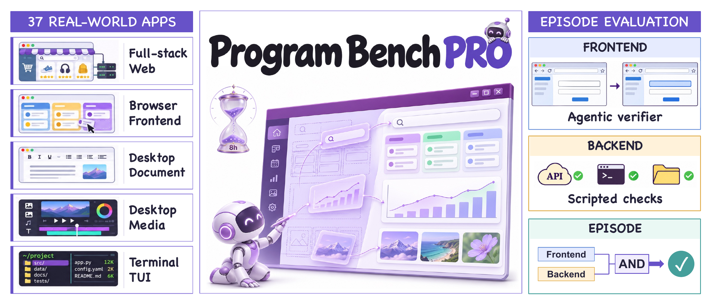
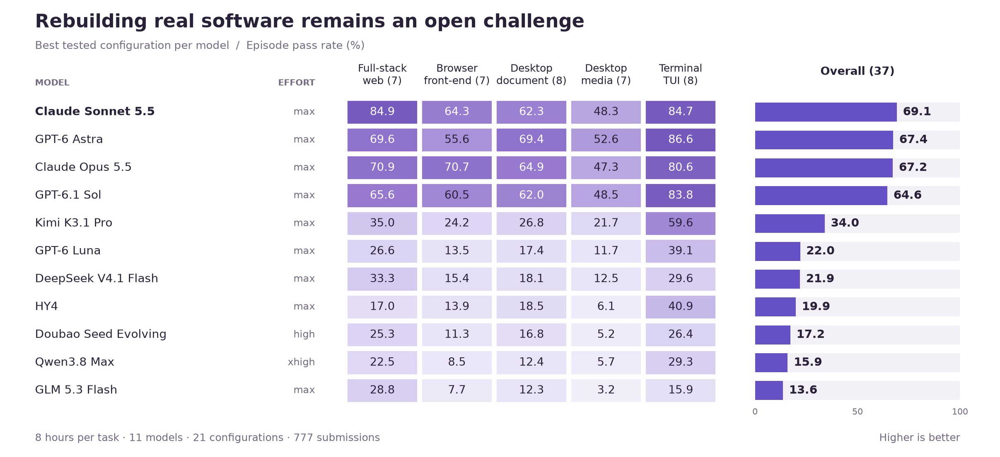

<div align="center">

# ProgramBench Pro

**Can coding agents rebuild real-world applications from black-box observation?**

37 applications · 5 categories · 3,756 episodes · 8 hours per task

[Overview](#what-it-measures) · [Run the benchmark](#running-it) · [Results](#results) · [All tasks](docs/tasks.md) · [Citation](#citation)

</div>



## What it measures

ProgramBench Pro asks a coding agent to build a complete application from scratch. The agent receives the application's name, a runtime contract, and access to a running reference through the `blackbox` interface. It has **eight hours to explore, implement, and self-test** its reconstruction.

The reference's source code, binaries, feature lists, and evaluation episodes are unavailable to the solving agent. Its network access is restricted to the configured model endpoint. The delivered implementation must work in a fresh, offline verifier environment.

The benchmark covers familiar software such as Gitea, Joplin, Zotero, Audacity, and lazygit. Evaluation tests complete usage scenarios, including the visible interface, persistent state, APIs, command-line behavior, and file formats.

| Category | Tasks | Examples | What the agent must reconstruct |
| --- | ---: | --- | --- |
| Full-stack web | 7 | Gitea, Grocy, Mealie | Browser workflows, services, APIs, and persistent state |
| Browser front-end | 7 | BentoPDF, Piskel, SVG-edit | Interactive editing, document state, and import/export |
| Desktop document | 8 | Joplin, Gnumeric, Zotero | Native interfaces, documents, and application semantics |
| Desktop media | 7 | Audacity, darktable, MuseScore Studio | Media workflows, processing, and file conversion |
| Terminal TUI | 8 | lazygit, micro, VisiData | Keyboard interaction, terminal state, CLI behavior, and files |

See the [complete task catalogue](docs/tasks.md) for pinned reference versions, interfaces, and episode counts.

## How it is graded

An **episode** is one complete usage scenario, starting from a clean application state. It passes only when **every scored checkpoint passes**.

| Check | How it is evaluated |
| --- | --- |
| Frontend | An agentic verifier operates the candidate and compares its functional behavior with recorded reference observations. Pixel-identical appearance is not required. |
| Backend | Deterministic scripts check APIs, CLI output, clipboard contents, files, and application state against frozen reference results. |

```text
Task reward = fully passed episodes / total episodes
Benchmark score = 100 × mean(task reward across all 37 tasks)
```

Episodes have equal weight within a task; tasks have equal weight in the benchmark. Frontend/backend point ratios are diagnostics. Incomplete or infrastructure-failed evaluations have **no valid reward** and must be recovered before reporting a full benchmark score. Diagnostic episode subsets also produce no formal reward.

Task recipes and frozen reference data are public in this repository. They are hidden from the solving agent by container and filesystem isolation during a run. The shared scorer is [`tools/scoring.py`](tools/scoring.py).

## Results

The paper evaluates **11 models at 21 model–effort configurations**, with one selected submission per task and configuration: **777 submissions** in total. The best overall score is **69.1%**, leaving substantial room for improvement.



The figure selects each model's best **overall** configuration. See [all 21 configurations](docs/paper-results.md) and the [aggregate results in JSON](results/paper-results.json) for the paper's reported results.

## Running it

Tasks use the [Harbor](https://harborframework.com/docs) format. The paper uses **Harbor 0.24.0**; follow its documentation for installation, agent configuration, and model access.

Use **Linux x86_64**, **Python 3.12+**, Docker Engine 23+, a recent Docker Buildx, Docker Compose v2 or newer, and a kernel with **Landlock ABI 1+** enabled. Source downloads require network access during the build. Model inference uses remote APIs; the benchmark itself does not require a local GPU.

The agent has a 4-vCPU / 16-GiB quota. Reference and verifier containers need additional resources, and verification has its own time and API budget. See [resource planning](docs/running.md#resources-and-compatibility) before running several tasks concurrently.

**Build a task.** Check the [Landlock prerequisite](docs/running.md#resources-and-compatibility), then run from the repository root. This example builds micro, a terminal editor:

```bash
TASK_DIR=tasks/terminal-tui-app/micro
RUN_DIR="$(mktemp -d /tmp/programbench-pro.XXXXXXXX)"
mkdir -p "$RUN_DIR/tmp"
export TMPDIR="$RUN_DIR/tmp" PYTHONDONTWRITEBYTECODE=1
bash "$TASK_DIR/environment/build.sh"
```

This builds and checks the task's base, agent, reference, and verifier images. The [program-only smoke test](docs/smoke-test.md) checks one reference episode without model API calls. Keep run outputs, temporary files, and credentials outside the checkout.

**Configure the frontend evaluator.** Verification uses a separate model through a host-side bridge because verifier containers are offline. Set its endpoint and credential, and connect a private bridge directory to each assessment as described in [benchmark setup](docs/running.md#frontend-evaluator). The paper uses `kimi-k3` at `high` effort. The task images preinstall Codex CLI 0.162.1 and Claude Code 2.1.296.

Report a full benchmark score only after all 37 tasks have complete, valid results. See [result aggregation](docs/running.md#aggregate-results) for the treatment of incomplete runs and infrastructure errors.

For an already saved implementation, [`tools/parallel_compare.py`](tools/parallel_compare.py) evaluates whole episodes in 1, 2, or 4 isolated verifier lanes and supports recovery from interrupted runs. Commands and output semantics are in [`tools/README.md`](tools/README.md).

## Repository layout

```text
tasks/<category>/<task>/
  task.toml       Harbor configuration and resource limits
  instruction.md Agent-facing task and delivery contract
  environment/   Build scripts, images, and black-box runtime
  solution/      Reference installation and third-party notices
  tests/         Episode definitions, verifier, and frozen reference data
tools/           Shared scoring and parallel verification
```

The reference installer in `solution/` is used by the oracle. It is excluded from the solving agent's image. Submitted code is collected from `/app/solution` and must satisfy the task's startup contract in [`instruction.md`](tasks/terminal-tui-app/micro/instruction.md). See the [maintainer notes](docs/maintaining.md) for recording new reference data and deciding when images or frozen bundles must be rebuilt.

## License

The benchmark's own code and documentation are released under [Apache-2.0](LICENSE). Reference applications, dependencies, and other third-party material retain their own licenses. Each task records these in `solution/LICENSE`, `solution/NOTICE`, `solution/LICENSES/` where present, and `solution/SOURCE.json`.

## Citation

```bibtex
@misc{hong2026programbenchpro,
  title  = {ProgramBench Pro: Can Coding Agents Rebuild Real-World Applications?},
  author = {Deyao Hong and Yixuan Shi and Yuchun Chen and Jiayi Jiang and
            Wenyi Li and Zheng Jiang and Erle Zhu and Junxiao Yang and
            Bo Zhang and Mingju Gao and Yizhe Chi and Youjie Zheng and
            Calvin Xiao and Kaisen Yang and Huan-ang Gao},
  year   = {2026}
}
```
